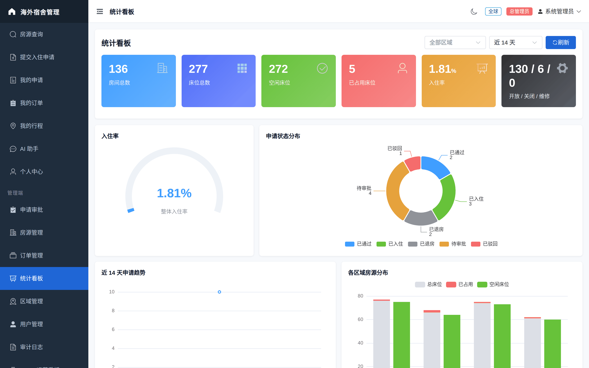
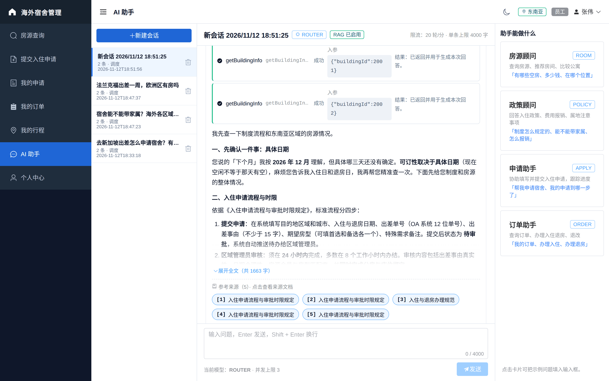
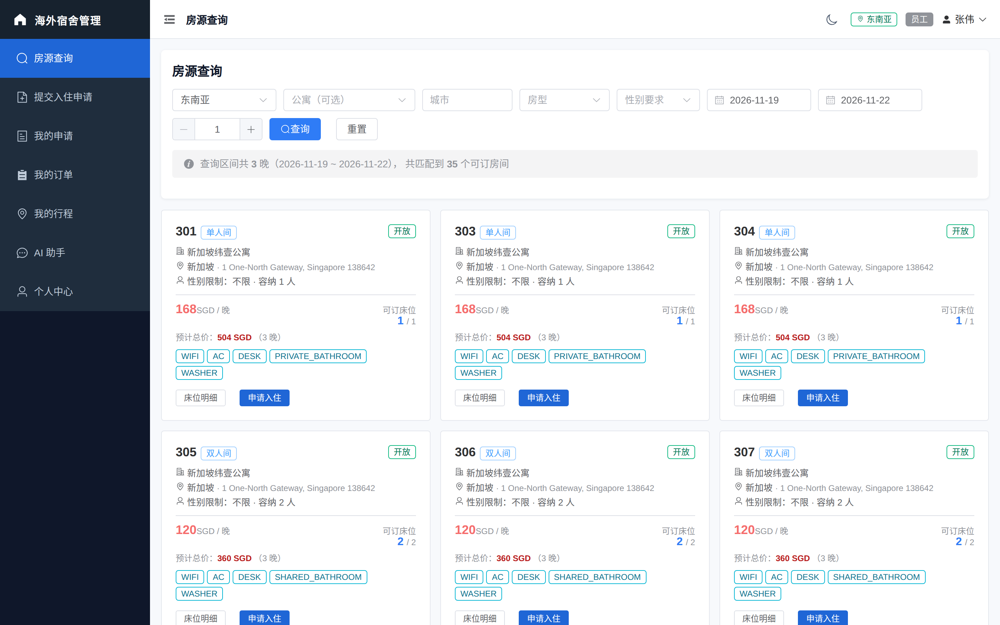
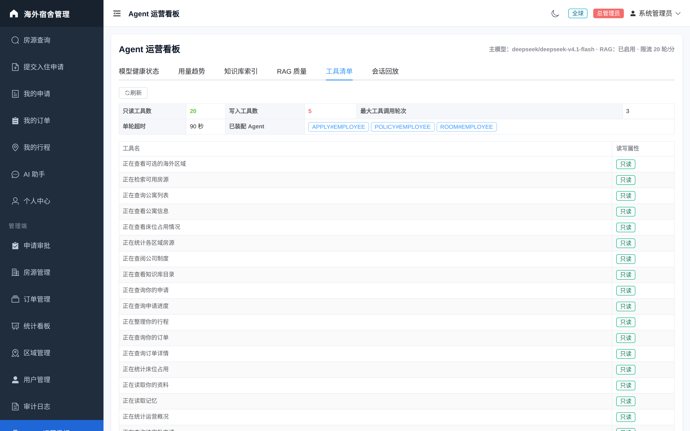

<div align="center">

# 海外宿舍管理平台 · dorm-platform

**业务 / AI Agent / 前端三服务独立拆分｜Java 21 · Spring Boot 3.5 · LangChain4j · Vue 3**

[](https://github.com/dddd-start/dorm-platform/actions/workflows/ci.yml)
[](https://openjdk.org/projects/jdk/21/)
[](https://spring.io/projects/spring-boot)
[](https://vuejs.org/)
[](./LICENSE)

把「宿舍查询 → 入住申请 → 审批分床 → 入住 / 退房 → 统计审计」这条行政业务链路做成三个可独立构建、
独立部署、独立扩缩的服务；并在业务边界之上加了一个**能真正调用业务接口**的流式 AI 助手：
流式输出可断线续传、回答带知识库引用、写操作受工具权限与护栏约束。

</div>

---

## 一、先看效果

| 管理端统计看板 | AI 助手（流式回答 + 引用 + 工具卡片） |
|---|---|
|  |  |

| 员工端房源查询 | Agent 运营看板（模型健康 / 用量 / 知识库 / 工具） |
|---|---|
|  |  |

> 更多截图与「每张图想证明什么」见 [`docs/screenshots/manifest.md`](docs/screenshots/manifest.md)；
> AI 助手流式输出的动图在 [`docs/screenshots/agent-stream.gif`](docs/screenshots/agent-stream.gif)。

---

## 二、这个项目解决了什么问题

| 问题 | 做法 | 结果 |
|---|---|---|
| 海外多地宿舍资源分散，区域管理员只能看本区数据 | 数据权限下沉到业务服务的 Mapper 层（区域 → 公寓 → 房间 → 床位）；用户与审计同样走 `DataScope` | 越权请求在 SQL 层或 Service 层被过滤，不依赖前端隐藏菜单 |
| 申请、审批、分床、入住、退房是一条状态机，人工改库容易错 | 状态机集中一处 + 幂等键 + 审计 | 27 项全流程回归 27/27 通过 |
| 多人同时抢同一张床位 | 条件更新（`where status='IDLE'`）而不是先查后改 | 抢床冲突返回业务错误，不产生双人入住 |
| 员工问「去新加坡出差怎么申请宿舍」要翻多份制度 | 知识库 RAG + 工具查实时房态 + 流式回答带引用 | 回答可溯源到具体制度，工具调用可见 |
| AI 写操作（提交申请 / 退房）风险高 | 工具目录区分读写 + 护栏 + 限流 + 审计 | 每次工具调用入库，可按轮次回放 |

---

## 三、架构：三个服务，三条数据边界

```
                         ┌────────────────────────────────────┐
   浏览器 ──────────────▶│ ui-service :8080                   │
                         │ Vue 3 构建产物 + 静态服务 / 反代    │
                         └──────────┬──────────────┬──────────┘
                          /api/**   │              │  /api/agent/**
                                    ▼              ▼
                  ┌──────────────────────┐   ┌──────────────────────────────┐
                  │ dorm-service :8081   │   │ agent-service :8082          │
                  │ 业务唯一写入方        │◀──│ LangChain4j / SSE / RAG      │
                  │ JWT + 数据权限 + 审计 │   │ 工具经 HTTP 调业务服务        │
                  └──────────┬───────────┘   └──────────┬───────────────────┘
                             │                          │
                     ┌───────▼────────┐         ┌───────▼────────┐
                     │ MySQL dorm_db  │         │ MySQL agent_db │
                     │ Redis 会话/锁  │         │ Redis 流缓冲   │
                     └────────────────┘         └────────────────┘
```

| 服务 | 端口 | 拥有数据 | 明确不做 |
|---|---|---|---|
| `dorm-service` | 8081 | `dorm_db`：区域、用户、公寓、房间、床位、申请、订单、审计、Outbox | 不装配模型、不写 Prompt、不产生 SSE |
| `agent-service` | 8082 | `agent_db`：会话、消息、归档、工具审计、用量、长期记忆、RAG 文档/切片/检索日志 | **不连业务库**，业务读写全部走 HTTP |
| `ui-service` | 8080 | 无（静态产物 + 反代） | 不持有业务状态、不直连数据库 |

**为什么拆**：Agent 直连业务库的话，"独立服务"只是换了个启动方式——表结构一变两边一起坏，
权限也绕过了业务服务的收口点。现在工具只依赖 `DormServiceClient`，身份靠**透传用户 JWT 重新校验**，
所有业务规则（床位占用、状态机、数据权限、审计）只在 `dorm-service` 里执行一次。
完整取舍见 [`docs/design-notes/architecture-decisions.md`](docs/design-notes/architecture-decisions.md)。

---

## 四、快速开始

### 方式 A：本机脚本（Linux，已实测）

```bash
git clone https://github.com/dddd-start/dorm-platform.git && cd dorm-platform

bash scripts/env-install.sh      # 可选：无 Docker 时，把 MySQL/Redis/Maven 准备到项目 env/ 下
bash scripts/env-start.sh        # 启动 MySQL(3307) / Redis(6380)，建库建账号（随机口令）
bash scripts/build.sh            # 构建两个 jar + UI 静态产物
bash scripts/demo.sh             # 一键：起服务 → 冒烟 → 打印演示账号与 5 分钟路线
```

访问 <http://127.0.0.1:8080>，接口文档 <http://127.0.0.1:8081/swagger-ui.html>。

### 方式 B：Docker Compose

```bash
export DORM_AI_API_KEY=<你的模型 Key>     # 不填则 AI 助手只能用离线 mock
docker compose -f deploy/docker-compose.yml up --build
```

五个容器：MySQL、Redis、dorm-service、agent-service、ui-service；库表由 Flyway 自动迁移，
种子数据在 `dorm-service/src/main/resources/db/migration/V2__seed_data.sql`；
`deploy/mysql-init/` 负责首次建库建账号，`ui-service/deploy/nginx.conf` 负责反代与 SSE 不缓冲。

> ⚠️ **仅限本机/内网演示**：`deploy/docker-compose.yml` 里的数据库口令、JWT secret、
> 内部服务令牌、手机号加密 key 都是**开发用固定值**，且服务默认监听 `0.0.0.0`。
> 上公网前必须全部换成环境变量注入，并收敛监听地址与 CORS 白名单（见「已知限制」第 1、10 条）。

### 演示账号（种子数据）

| 账号 | 密码 | 角色 |
|---|---|---|
| `superadmin` | `Dorm@123456` | 总管理员（全部区域 + Agent 运营看板） |
| `sea.admin` / `eu.admin` / `me.admin` / `nea.admin` | `Dorm@123456` | 区域管理员（只看到本区数据） |
| `zhangwei` / `liuyang` / `chenjing` … | `Dorm@123456` | 员工 |

### 5 分钟演示路线

`bash scripts/demo.sh` 会把这条路线打印出来：

1. **房源查询** → 选区域、看房态与床位 → 证明数据权限按区域收口
2. **提交入住申请** → 填日期提交 → 证明状态机与幂等（重复提交不会产生脏申请）
3. **管理员审批** → 分配床位 → 证明并发抢床用条件更新，不会双人入住
4. **入住 / 退房** → 订单详情 → 证明订单、房态、账单联动
5. **统计看板** → 入住率 / 区域分布 → 证明聚合统计与缓存
6. **AI 助手** → 问「上海员工去新加坡出差，怎么申请宿舍？」→ 证明 RAG 引用 + 工具调业务 HTTP + SSE 流式
7. **Agent 运营看板** → 模型健康 / token 用量 / 知识库 / 工具审计 → 证明可观测性
8. **审计日志** → 最近操作 → 证明可回溯

---

## 五、技术栈

| 层 | 选型 |
|---|---|
| 后端 | Java 21、Spring Boot 3.5.16、MyBatis-Plus 3.5.17、Flyway、springdoc-openapi |
| 存储 | MySQL 8.4（`dorm_db` / `agent_db` 两 schema，**同实例逻辑隔离**）、Redis 8（会话白名单 / 认证版本 epoch / 流缓冲 / 限流） |
| AI | LangChain4j 1.22.0（OpenAI 兼容协议）、JDK HttpClient + 虚拟线程、本地 bge-small-zh-v1.5 向量化 |
| 前端 | Vue 3.5 + Vite 6 + TypeScript + Element Plus + Pinia + ECharts |
| 构建/运行 | Maven 多模块（contract / dorm / agent）、Node 24、`scripts/*.sh`、Docker Compose |
| 质量 | 138 个单测（零外部依赖）、GitHub Actions CI、12 项冒烟、27 项全流程回归（`scripts/regression.sh`，可复跑）、Playwright 页面检查 |

---

## 六、关键设计（挑几个能被追问的）

### 6.1 SSE 流式协议：事件可续传、跨实例

- 事件：`START` / `REASONING` / `DELTA` / `TOOL` / `REFERENCE` / `DONE` / `BLOCKED` / `INTERRUPTED` / `ERROR`，
  `id` 即 seq，客户端用于去重与续传；心跳是注释帧 `:ping`，不占 seq、不触发 `onmessage`。
- **先写 Redis Stream 再投递 Pub/Sub**：投递失败不影响续传；`GET /api/agent/chat/stream/{messageId}?lastEventId=N`
  可以从第 N 条接着收，因此**无需粘性会话**，重启 / 换实例都能续。
- 两种接入：浏览器走 `POST` + `fetch` 流式读取（可带 `Authorization`）；受限 WebView 走标准 `EventSource`。
- 模型回调不在请求线程：用**专用虚拟线程**跑 `StreamingChatModel`，回调里显式恢复用户身份 + traceId + 轮次上下文。
- 完整链路（准入、事件流水线、收口、背压、断线续传）见 [`docs/agent-sse-design.md`](docs/agent-sse-design.md)。

### 6.2 工具与权限：25 个工具，读写分离

- 工具目录 `ToolCatalog`：25 个工具（房源、政策、申请、订单、资料记忆、运维），每个带中文标签与 `readOnly` 标记；
- 单轮最多 6 次工具调用 / 3 轮工具往返，超限收口并审计；
- 工具的数据来源只有 `DormServiceClient`（HTTP + 用户 JWT + 服务间令牌），业务服务重新鉴权后才执行；
- 每次调用落 `agent_tool_call`，可按会话回放。

### 6.3 RAG：知识库 + 引用 + 可评测

- 10 篇制度 / 指南（Markdown + front-matter），启动时切片入库：**110 个切片**；嵌入用本地 bge-small-zh-v1.5，**不依赖外部 embedding 服务**；
- 检索：向量召回 + MMR（λ=0.7）+ 相似度阈值（min-score 0.55）+ top-k 5，检索结果缓存 300s；
- 回答里的 `REFERENCE` 事件携带文档、章节、片段与相似度，前端可点开原文；
- 检索质量有评测语料与脚本：`agent-service/src/main/resources/rag-eval/`。

### 6.4 安全：身份、数据权限、护栏、限流

- 登录签发 JWT，同时写 Redis **会话白名单 + 认证版本 epoch**；登出 / 改密 / 强制下线通过 epoch 让旧 token 立刻失效；
- 服务间调用 `/internal/**` 需 `X-Internal-Token`，且仍要透传并重新校验用户 JWT（服务身份 ≠ 用户身份）；
- **员工手机号**（`sys_user.phone`）以 AES-256-GCM 密文入库，列表与 Prompt 只出现掩码（公寓联系人电话仍是明文，见「已知限制」）；提示词注入检测 + 内容护栏 + 流式窗口拦截；
- 限流：20 轮/分钟（突发 5）、单用户 3 条并发流、全局 1000 条、每日 token 预算可配；超限有 `BLOCKED` 事件与明确原因。

### 6.5 一致性：Outbox + 幂等

- 业务写操作与待发事件同事务写 `outbox_event`，由调度任务兜底投递；
- 投递前用**条件更新领取**（`NEW/FAILED → SENDING`），多实例部署时同一条事件只有一个实例能投；
  进程崩溃留在 `SENDING` 的事件会被超时回收成 `FAILED` 再重试（`OutboxEventMapper#claim` / `#recoverStale`）；
- Agent 建申请带幂等键（同一轮次重复提交不重复建单）；
- 跨服务写按**最终一致**处理：幂等键 + 审计对账 + Outbox 重试；同一笔业务只在 `dorm-service` 落库一次，避免"两边各写一半"。

---

## 七、数据模型

```
dorm_db                             agent_db
├── region                           ├── agent_conversation
├── sys_user                         ├── agent_message / agent_message_archive
├── dorm_building                    ├── agent_tool_call
├── dorm_room                        ├── agent_usage_daily
├── dorm_bed                         ├── agent_long_memory
├── stay_apply                       ├── agent_feedback / agent_task
├── stay_order                       ├── agent_pending_approval
├── audit_log                        ├── rag_document / rag_chunk
└── outbox_event                     └── rag_retrieval_log
```

两个库**逻辑隔离**（同一 MySQL 实例的两个 schema，部署时可拆成两个实例）：`dorm_db` 只有业务表，`agent_db` 只有 Agent / RAG 表；没有跨库外键，
跨库一致性靠「用户 JWT 重新校验 + 幂等键 + 审计对账」，不靠共享表。

---

## 八、测试与验收（数字都能复跑）

```bash
mvn test                     # 138 个单测：contract 47 + agent 91，失败 0；不需要 DB / 模型 / Key
bash scripts/smoke.sh        # 12 项冒烟：健康检查 → 登录 → 业务接口 → Agent SSE
bash scripts/regression.sh  # 27 项全流程回归（真实建单/审批/入住链路）
bash scripts/demo.sh --check # 演示前置检查
node scripts/ui-check.mjs    # Playwright 页面检查（需自行安装 playwright）
```

| 项目 | 结果 | 怎么复跑 |
|---|---|---|
| 单元测试 | **138 / 138 通过**（契约层 47 + Agent 91，覆盖状态机、跨线程上下文、SSE 通道契约、工具权限、护栏） | `mvn test`（零外部依赖，CI 里同样跑） |
| 冒烟（三服务 + SSE） | **12 / 12 通过** | `bash scripts/smoke.sh` |
| 业务全流程回归 | **27 / 27 通过**（服务就绪 → 认证与权限 → 查房 → 申请与幂等 → 审批分床 → 入住/退房与审计） | `bash scripts/regression.sh`（需先 `env-start.sh && build.sh && start.sh`） |
| 浏览器页面检查 | 登录跳转、`/rooms`、`/admin/dashboard`、`/agent`、`/admin/agent-ops` 渲染正常、控制台无 error | `node scripts/ui-check.mjs`（需自行 `npm i playwright`） |
| 知识库装载 | 10 篇文档 / 110 个切片，区域文档解析出 `region_id` | `GET /api/agent/admin/knowledge` |

> 诚实边界：单测与 12 项冒烟进了 CI（零外部依赖，托管 runner 可直接跑）；
> **27 项回归需要真实 MySQL/Redis，不在 CI 内**，靠本地 `scripts/regression.sh` 一键复跑。

CI（`.github/workflows/ci.yml`）：JDK 21 + Maven 缓存跑后端单测，Node 24 跑 `npm ci && npm run build`；
**工作流内零 secrets、零外部服务**，因为单测刻意设计成零外部依赖。

---

## 九、目录结构

```
dorm-platform/
├── pom.xml                     父 POM（contract / dorm / agent 三模块）
├── dorm-contract/              服务间共享契约：统一响应、枚举、身份、DTO/VO、实体、状态机
├── dorm-service/               业务服务（Spring Boot + MyBatis-Plus + Flyway）
│   └── src/main/java/...       业务 Controller / Service / Mapper / 数据权限 / 内部 API
├── agent-service/              AI 服务（Spring Boot + LangChain4j）
│   └── src/main/java/...       Agent 编排 / 工具 / RAG / 记忆 / 护栏 / SSE / 业务 HTTP 客户端
├── ui-service/                 Vue 3 + Vite + Node 静态服务（反代 SSE）
├── deploy/                     Dockerfile、Compose、MySQL 初始化
├── scripts/                    env / build / start / demo / smoke / 浏览器检查
├── docs/                       架构、SSE 全链路、拆分说明、验收、回归对照、设计决策与踩坑
└── config/                     配置模板（真实 .env 已 gitignore）
```

---

## 十、文档索引

| 想了解 | 看这个 |
|---|---|
| 关键设计决策与 17 个真实踩坑 | [`docs/design-notes/`](docs/design-notes/README.md) |
| 服务边界与模块设计 | [`docs/architecture.md`](docs/architecture.md) |
| SSE 流式全链路（准入 → 生成 → 收口 → 续传 → 背压） | [`docs/agent-sse-design.md`](docs/agent-sse-design.md) |
| 为什么这么拆、代码落在哪 | [`docs/migration.md`](docs/migration.md) |
| 验收记录与实测数字 | [`docs/verification.md`](docs/verification.md) · [`docs/parity.md`](docs/parity.md) |
| 7 张架构 / 时序图 | [`docs/diagrams/`](docs/diagrams) |
| 截图清单 | [`docs/screenshots/manifest.md`](docs/screenshots/manifest.md) |

---

## 十一、已知限制

这个项目是个人练手性质，没有线上流量。下面这些点**确实没做到**，
列出来是为了把"能力边界"讲清楚，而不是包装成"已完成"：

| # | 限制 | 现状 | 如果上线会怎么改 |
|---|---|---|---|
| 1 | **27 项回归不进 CI** | 需要真实 MySQL/Redis，`scripts/regression.sh` 本地一键复跑；CI 只跑零依赖的 138 单测 | 用 Testcontainers 起 MySQL/Redis，或给 runner 加 compose 服务 |
| 2 | **公寓联系人电话是明文** | 只有员工手机号走了 AES-256-GCM；`building.contact_phone` 未加密 | 同一套 `PhoneCipher` 复用过去，或改成只存分机 |
| 3 | **`/actuator/prometheus` 不存在** | `application.yml` 里写了 exposure 但 pom 没加 `micrometer-registry-prometheus`，实际 404；只有 `/actuator/health`、`/metrics` 可用 | 加一个依赖即可，或把配置项删掉避免误导 |
| 4 | **提前预订语义有限** | `availableBeds` 是"此刻可分配的床位数"，不校验未来日期区间冲突（提前 6 个月可提交申请，但床位是快照模型） | 上 `bed_occupancy(bed_id, date_from, date_to)` 区间表 + 唯一约束 |
| 5 | **审计异步写不参与事务** | `AuditService` 用独立线程写库；业务回滚时可能留下"操作已成功"的假审计 | 改 `@TransactionalEventListener(AFTER_COMMIT)`，或审计与业务同事务 |
| 6 | **区域隔离的审计面** | 业务数据（房间/申请/订单）已收口；`audit_log` 表没有 `region_id`，多态 target 无法反查区域，区域管理员看审计只能靠角色门禁 | 写入时固化 `region_id` 字段，查询时直接按列过滤 |
| 7 | **写操作的幂等窗口** | 幂等键无 TTL、全局唯一；同一键跨用户会冲突 | 加 `(user_id, key)` 联合唯一 + TTL |
| 8 | **Agent 的"停止生成"只停本地推送** | 取消后上游模型 HTTP 流仍在跑（LangChain4j 不暴露 abort 句柄），token 仍在计费 | 换支持中断的客户端，或把调用改成可 cancel 的异步任务 |
| 9 | **长期记忆是模型自由文本** | 原样拼进 system prompt，未做不可信内容包裹 | 结构化字段 + 白名单 + 注入检测后再回灌 |
| 10 | **CORS 放得较宽** | 允许 `192.168.*` / `10.*` 任意来源且 `allowCredentials=true`（为了内网多机调试） | 收敛成配置白名单 |

安全相关的三条（token 吊销、跨区越权、写路径 SQL 注入）在 2026-11 这轮里**已经修掉**，
对应改动见 `git log` 与 `docs/design-notes/`。
