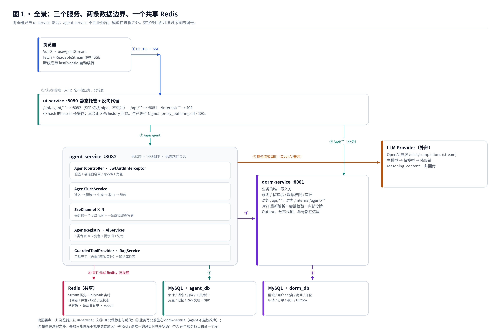
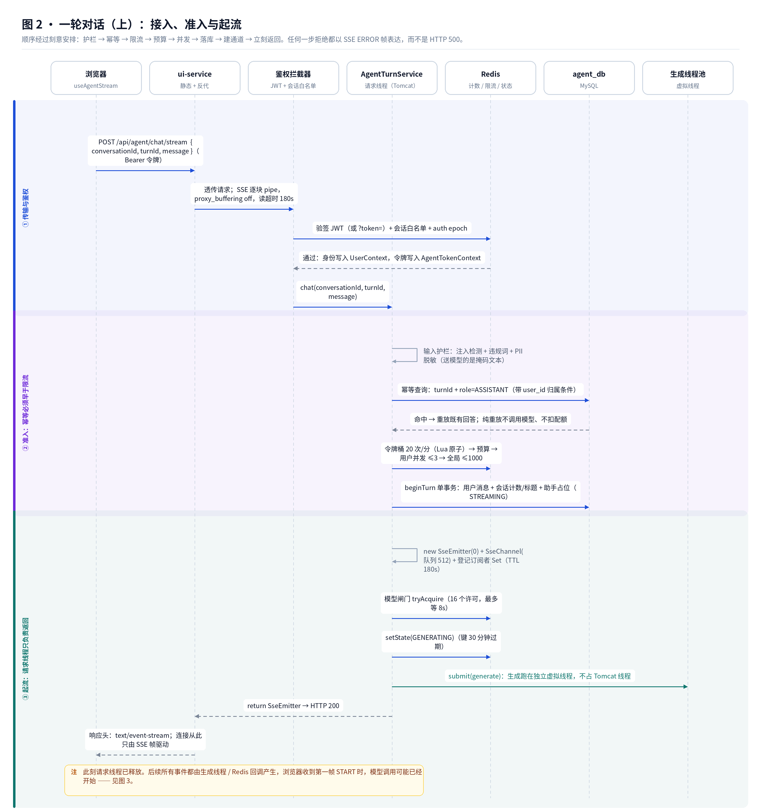
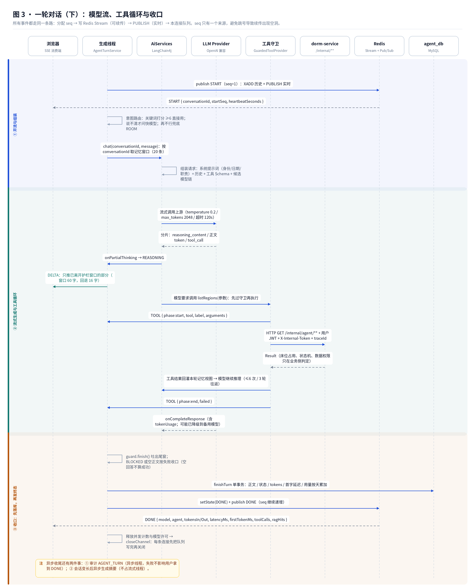
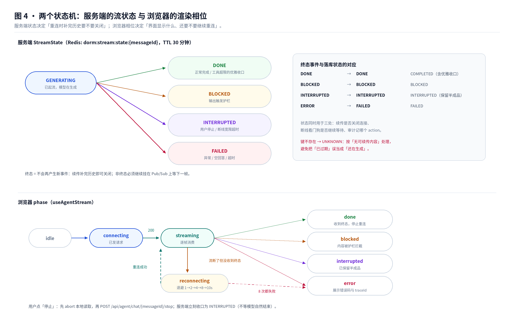
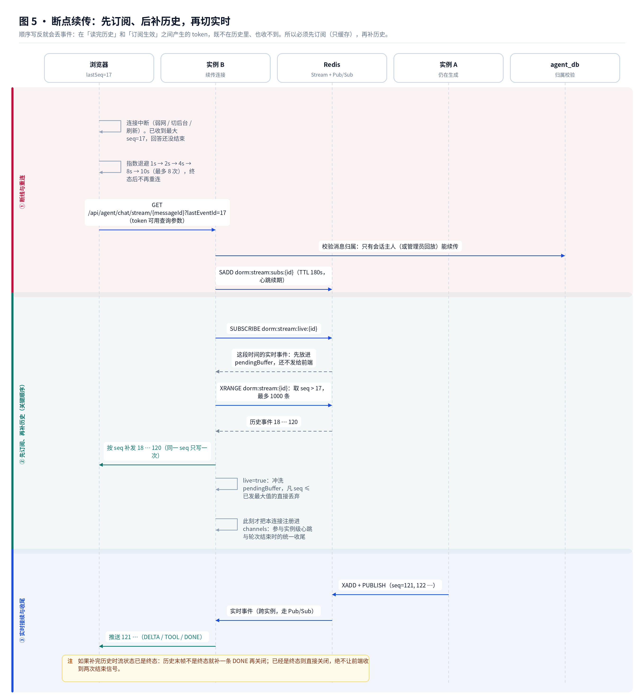
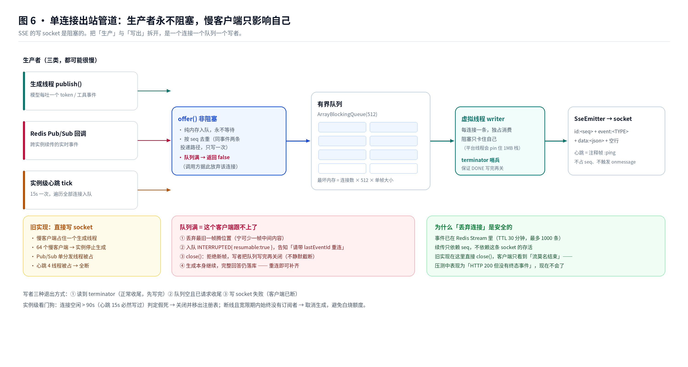
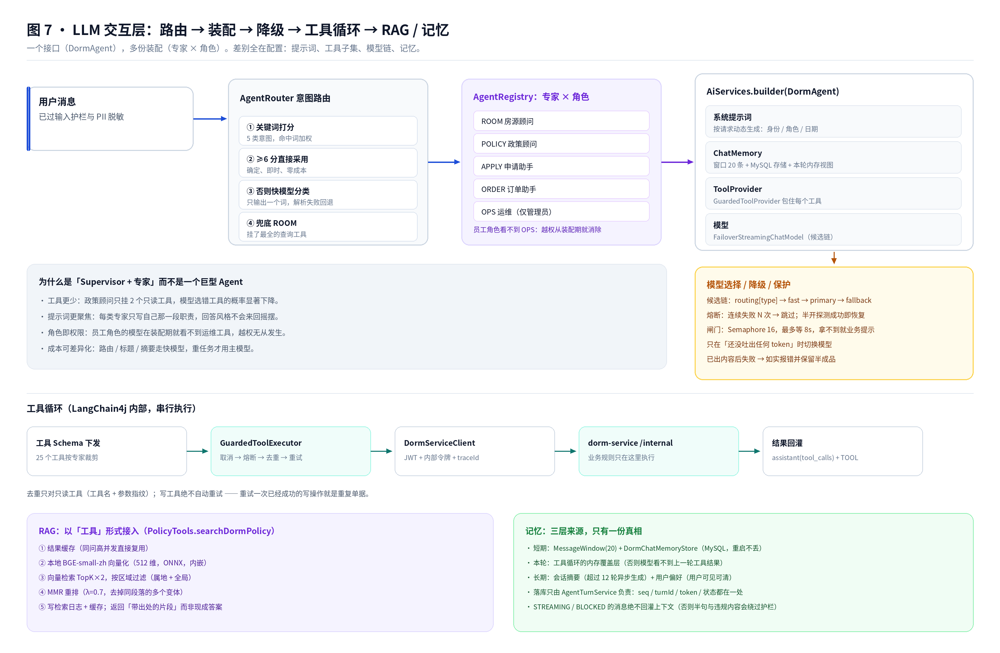

# Agent 流式链路详解：SSE、断点续传与 LLM 交互

> 这份文档只回答一件事：**一轮 AI 对话从按下回车到看到「已完成」，中间到底发生了什么。**
> 图比字重要：先看图，再看每张图下面的「为什么这么设计」。
>
> 图由 [`scripts/gen-agent-diagrams.py`](../scripts/gen-agent-diagrams.py) 生成（纯 Pillow，无浏览器/Mermaid 依赖）。
> 改了链路上的数字或流程，改脚本里的一个常量、重跑一次即可，不会出现「图画的是上一版设计」。
>
> 阅读顺序建议：图 1（全景）→ 图 2（接入）→ 图 3（生成）→ 图 4（状态机）→ 图 5（续传）→ 图 6（背压）→ 图 7（LLM 层）。

---

## 0. 30 秒速览

一轮对话被切成 6 个阶段，每个阶段都有明确的「谁负责、失败怎么办」：

| # | 阶段 | 执行位置 | 主要动作 | 失败时 |
|---|---|---|---|---|
| 1 | 传输 | ui-service 反代 | SSE 逐块透传，不缓冲 | 502（Agent 不可用） |
| 2 | 鉴权 | `JwtAuthInterceptor` | 验签 + 会话白名单 + auth epoch | 401 JSON（还没开始流） |
| 3 | 准入 | 请求线程 | 输入护栏 → 幂等 → 限流 → 预算 → 并发 → 落库 | SSE `ERROR` 帧（HTTP 仍是 200） |
| 4 | 起流 | 请求线程 | 建连接通道、登记订阅者、提交生成任务 | 同上 |
| 5 | 生成 | 业务虚拟线程 + 模型流虚拟线程 | 路由 → 组装 → 模型流 → 工具循环 → 护栏 | `ERROR` / `INTERRUPTED` 帧 |
| 6 | 收口 | 生成线程 | 单事务落库 → 发终态 → 关连接 | 审计异步补偿 |

支撑这一切的是三条**不变量**，后面所有复杂设计都是为了守住它们：

1. **seq 单调且唯一**：一条流里的每个事件只有一个序号来源，重复投递按 seq 丢弃。
2. **先写 Redis，再投递**：任何事件先 `XADD` 进 Stream（可续传），再 `PUBLISH`（实时）。投递失败不影响续传。
3. **生产者永不阻塞**：生成线程 / Pub/Sub 回调 / 心跳只做「入队」，写 socket 由每连接一条虚拟线程负责。



---

## 1. 全景：三个服务、两条数据边界、一个共享 Redis

| 组件 | 拥有什么 | 绝不做什么 |
|---|---|---|
| `ui-service` :8080 | 静态产物 + 反代规则 | 不存业务状态、不直连数据库、不做业务判断 |
| `dorm-service` :8081 | `dorm_db`：业务唯一写入方 | 不装配模型、不写 Prompt、不产生 SSE |
| `agent-service` :8082 | `agent_db`：会话/消息/工具审计/用量/记忆/RAG | **不连业务库**，业务读写全部走 HTTP |
| Redis | 流缓冲、Pub/Sub、订阅者、并发计数、限流、登录会话 | 不是业务数据的真相来源 |
| LLM Provider | 模型能力 | 在进程之外，只能降级、不能“重试式放大” |

Redis 在这一条链路上承担 6 件事，且都带 `dorm:` 前缀按域隔离：

1. `dorm:stream:{messageId}` —— 事件历史（Stream，`MAXLEN ~1000`，TTL 30 分钟）
2. `dorm:stream:live:{messageId}` —— 实时广播（Pub/Sub）
3. `dorm:stream:subs:{messageId}` —— 「还有谁在收」的订阅者集合（TTL 180 秒）
4. `dorm:stream:user:{userId}` / `dorm:stream:global` —— 并发流计数
5. `dorm:stream:state:{messageId}` / `dorm:stream:cancel:{messageId}` —— 流状态 / 取消标记
6. `dorm:ratelimit:agent:turn:{userId}` —— 令牌桶；`dorm:auth:*` —— 登录会话与 epoch

**为什么这些必须放 Redis 而不是 JVM 内存**：agent-service 是无状态的、可多副本。
「这个用户已经有几条流在跑」「这条流还有没有人接收」「这一轮结束没有」——
只要有一个判断放在单实例内存里，跨实例续传就会误判（详见 §6.3）。

---

## 2. 接入与起流：请求线程只做「准入 + 交棒」



### 2.1 顺序为什么是这一个

`AgentTurnService.doChat()` 里的顺序不是随手排的，换一下就会出现"花的是重试的钱、拦的是真实的提问"：

| 顺序 | 步骤 | 为什么必须在这个位置 |
|---|---|---|
| 1 | 输入护栏（注入 / 违规词 / PII 脱敏） | 必须在任何持久化之前：被判定为注入的内容不该进库、也不该进上下文 |
| 2 | **幂等预检**（`turnId + role=ASSISTANT`） | 必须早于限流。纯重放不调模型、不占资源，因而不该扣配额 |
| 3 | 令牌桶（20 次/分，Lua 原子） | 固定窗口计数在边界会放过 2 倍流量，令牌桶平滑补充 + 允许突发 |
| 4 | 预算守卫（默认关闭，`daily-token-budget=0`） | 超预算优先「降级到精简模式」，而不是把用户挡在门外 |
| 5 | 并发流上限（用户 3 / 全局 1000） | 用 Redis `INCR` 计数，多实例下才是全局约束 |
| 6 | 会话归属 + `beginTurn` | 用户消息、会话计数/标题、助手占位在**一个事务**里写完 |
| 7 | 建通道 + 登记订阅者 + 模型闸门 | 初始连接也必须登记订阅者，否则会被看门狗当成"无人接收" |
| 8 | 提交生成任务 → 返回 `SseEmitter` | 请求线程到此结束，Tomcat 线程被释放 |

### 2.2 几个容易写错的地方

**① 业务拒绝也要走 SSE，而不是 HTTP 500。**
限流、并发超限、预算、护栏拒绝，全部由 `chat()` 捕获 `BizException` 后返回一个"只发一帧 `ERROR` 就关闭"的 emitter。

注意：模型闸门是在**通道与订阅者已经注册之后**才申请的。因此 `doChat` 的 catch 必须回滚
`channels`、Redis 订阅者、`localSubscriberIds` 与流状态，外层 finally 还要归还 user/global 并发计数；
否则 `chat()` 返回的是另一个 `errorEmitter`，原 emitter 会永久留在 `channels` 里，心跳不断往它的
`earlySendAttempts` 塞帧、订阅键被永久续期，看门狗也不会回收。
前端因此只需要一套解析逻辑：连接建立 → 收帧 → 按 `event` 分派。双形态契约（JSON 错误 + SSE 错误）在实际联调中几乎一定会漏掉一种。

**② 幂等键是 `turnId`，不是 `messageId`。**
`turnId` 由前端 `crypto.randomUUID()` 生成，重连/重试复用同一个。数据库 `(turn_id, role)` 唯一索引兜底：
并发重复提交时，败者会被 `beginTurn` 的 `DuplicateKeyException` 拦下，转成"重放既有回答"或"这一轮正在生成中"，
**绝不会再生成一次、再计一次费**。

**③ 起流后立刻返回，生成放到虚拟线程。**
`streamExecutor` 是 `newVirtualThreadPerTaskExecutor()`。平台的"每线程 1MB 栈"在 1000 并发下就是 1GB，
这才是"人一多容器就挂"的直接原因；虚拟线程把等待上游模型的时间让给载体线程。
容量上限由业务层的 Redis 计数（3/1000）把守，而不是由本地线程池把守。

这里实际有**两条**虚拟线程，职责不要混：

| 线程 | 谁创建 | 负责 |
|---|---|---|
| `agentStreamExecutor`（`virtual-*`） | `ExecutorConfig` | 一轮的编排：路由、组装、`TokenStream.start()`、等终态、收口 |
| `agent-model-stream-*` | `VirtualThreadJdkHttpClient` | 模型 SSE 的读循环、token 回调、工具执行、每 token 的 Redis 写 |

模型流**不在** `agentStreamExecutor` 里跑，也**不在** `ForkJoinPool.commonPool` 里跑；
后者是 LangChain4j 默认 `JdkHttpClient` 的行为，见 §3.1.1。

**④ 模型闸门是独立的一层。**
容器能容纳 1000 条流 ≠ 可以向模型服务商并发 1000 次调用。`ModelConcurrencyGuard` 是 16 个许可、最多等 8 秒，
拿不到就用**业务可读的提示**快速失败（"当前咨询人数较多"），而不是把 429 风暴打给上游、再被熔断放大。

---

## 3. 生成与收口：一条事件流水线



### 3.1 回调 → 事件

LangChain4j 的 `TokenStream` 是异步的：`start()` 只负责发起。回调发生在
`VirtualThreadJdkHttpClient` 的 `agent-model-stream-*` 虚拟线程上（模型 SSE 的读循环就在这条线程里），
不是请求线程，也不是 commonPool。所以每个回调都要先恢复「用户身份 + traceId + 轮次上下文」，再决定发什么事件：

| 回调 | 事件 | payload 关键字段 | 说明 |
|---|---|---|---|
| `onPartialThinking` | `REASONING` | `text` | 推理模型的思考过程，与正文分开渲染 |
| `onPartialResponse` | `DELTA` | `text` | 只推「已离开护栏窗口」的部分（窗口 60 字，回退 16 字） |
| `beforeToolExecution` | `TOOL` | `phase=start, tool, label, arguments` | `label` 来自 `ToolCatalog`，前端直接显示"正在检索可用房源" |
| `onToolExecuted` | `TOOL` | `phase=end, failed` | 只回填最后一个同名且仍在运行的工具卡片 |
| `onRetrieved` | `REFERENCE` | `count, references[]` | 自动检索命中时立即发；空列表不发送，避免把已有引用清空 |
| 轮次收尾 | `REFERENCE` | `count, references[]` | 工具式 RAG 的命中在 `AgentTurnContext` 里累计，`DONE` 前统一发一次；同时随消息落库（见 §8.6） |
| `onCompleteResponse` | `DONE` | `model, agent, tokensIn/Out, latencyMs, firstTokenMs, toolCalls, ragHits, status` | 终态；`status` 可能是 `COMPLETED/BLOCKED/FAILED` |
| `onError` | `ERROR` / `INTERRUPTED` | `message, status, graceful, traceId` | 取消中 → `INTERRUPTED`；工具往返超限但已有正文 → 优雅收口发 `DONE` |

#### 3.1.1 为什么模型流不能跑在 `ForkJoinPool.commonPool`

LangChain4j 1.22 的 `OpenAiStreamingChatModel` 默认走 `JdkHttpClient`：

```text
HttpClient.sendAsync(...).thenAccept(resp -> parser.parse(resp.body(), listener))
```

`thenAccept` 在“完成 future 的线程”上执行，JDK 把这条链交给 `CompletableFuture` 的默认执行器：

- `common.parallelism > 1`：`ForkJoinPool.commonPool()`；
- `common.parallelism == 1`（典型 2 核容器）：退化为 thread-per-task；
- 无论哪种，**整个 SSE 读循环都占着这条线程**，直到模型输出 `[DONE]`。

后果是“聊天流并发数”不再由 `max-streams-global` / `max-concurrent-calls` 决定，而由 JVM 公共池决定；
每 token 的 Redis `XADD/TRIM/EXPIRE/PUBLISH`、护栏、工具 HTTP 也都压在这个公共池线程上。
30 并发看不出来，1000 并发就是“请求把容器 hang 住”。

修复：`VirtualThreadJdkHttpClient` 用同步 `HttpClient.send(...)` 在专用虚拟线程里读 SSE，
再交给 LangChain4j 的 `ServerSentEventParser`；非流式调用仍委托 `JdkHttpClient`，
以保持错误映射、multipart、超时行为一致。

回归测试：

- `VirtualThreadJdkHttpClientTest`：直连 SSE 服务，断言回调线程是 `agent-model-stream-*` 虚拟线程；
- `StreamingChatModelCallbackThreadTest`：端到端跑 `OpenAiStreamingChatModel`，断言 token/完成回调不在 commonPool。

### 3.2 seq 只能有一个来源

`generate()` 里有一个 `AtomicLong sequence`，从 `START` 的 `1` 开始，之后每次 `publish` 都 `incrementAndGet()`。
曾经混用过「本地数组 + 读 Redis 的 lastSeq」两个来源，结果是序号跳号 —— 断点续传时出现空洞。
现在连收尾的 `BLOCKED/DONE` 都用同一个 `sequence`，不再从 Redis 取号。

### 3.3 收口：先落库，再发终态

`finishSuccessfully` 做四件事，顺序不能反：

1. `guard.finish()` 吐出尾窗（只推送、**不回写** `answer`，否则落库内容会比推送多一个窗口）；
2. 空正文判定：非阻断但正文为空 → `FAILED`（实测曾有 5.3% 的"成功但空白"气泡）；
3. `finishTurn` 单事务：正文 / 状态 / tokens / 首字延迟 / 用量按天累加；
4. `setState(DONE)` + `publish(DONE)` + 审计，最后 `closeChannel` 让每条连接**把队列写完再关**。

> 注：空正文的终态事件仍是 `DONE`（payload 里 `status=FAILED`），审计 action 仍记 `AGENT_TURN`，
> 真实状态在 `detail.status` 里。排障时看 `status`，不要只看事件名。

---

## 4. SSE 协议：帧、事件与心跳

### 4.1 帧格式

```
id:17
event:DELTA
data:{"text":"位于新加坡的…","messageId":9001,"traceId":"a1b2c3"}

```

- `id` 就是 seq，客户端用它去重与续传；
- `data` 一定是单行 JSON（`SseEmitter` 会把多行 data 拆成多行 `data:`，前端解析时要拼接）；
- 心跳是**注释帧** `:ping`（没有 `id`、没有 `event`，不触发 `onmessage`，不占 seq）。

### 4.2 事件表

| 事件 | 终态 | 前端动作 |
|---|---|---|
| `START` | 否 | 记录 `messageId / conversationId / turnId`，切到 `streaming` |
| `REASONING` | 否 | 追加到"思考过程"折叠区 |
| `DELTA` | 否 | 追加正文 |
| `TOOL` | 否 | `start` 新建工具卡片，`end` 回填成功/失败 |
| `REFERENCE` | 否 | 覆盖式渲染引用来源；工具检索与自动检索都会产生（见 §8.6） |
| `HUMAN_REQUIRED` | 否 | **预留事件**：两阶段写操作尚未实现，后端不会发出 |
| `DONE` | **是** | 填 token/耗时统计，停止重连 |
| `BLOCKED` | **是** | 展示拦截原因，停止重连 |
| `INTERRUPTED` | **是** | 保留半成品 + 提示"已停止"，停止重连 |
| `ERROR` | **是** | 展示 `code` 与 `traceId`，停止重连 |

`HUMAN_REQUIRED` 在契约里、在 `MetaController` 的下发列表里，但当前没有任何代码路径会发出它 ——
`AgentTurnContextTest` 里有一条断言专门钉住这个事实，避免有人误以为它已经实现。

### 4.3 两种客户端接入方式

```text
PC / 现代浏览器（推荐）：
  POST /api/agent/chat/stream        + Authorization: Bearer <jwt>
  → 读 response.body 的 ReadableStream，自己按帧解析；可 POST、可带请求头

小程序 / 受限 WebView：
  GET /api/agent/chat/stream/{messageId}?lastEventId=17&token=<jwt>
  → 标准 EventSource 即可消费（服务端拦截器显式支持 ?token=）
```

两条路径共用同一套事件契约与同一份 Redis 缓冲。

---

## 5. 前端：为什么不用 EventSource，以及它怎么重连



### 5.1 不用 EventSource 的三个理由

1. 需要 **POST**（`conversationId + turnId + message` 放 body）和自定义 `Authorization` 头；
2. 需要自己控制重连节奏（指数退避、终态后不再重连、用户主动停止）；
3. 需要区分「流正常结束」与「连接断了但没收到终态」——`EventSource` 的 `onerror` 说不清这两件事。

所以走 `fetch` + `response.body.getReader()`，解析逻辑抽在 `ui-service/src/utils/sse.ts`（纯函数、可单测）：

- `parseFrame(block)`：解析 `id/event/data`，忽略以 `:` 开头的注释行；
- `extractFrames(buffer)`：按空行切帧，**保留不完整的 rest**（网络分片会把一帧切成两半）；
- `backoffDelay(n)`：`min(1000 * 2^n, 10000)`。

### 5.2 状态机

| phase | 含义 | 出口 |
|---|---|---|
| `idle` | 没有进行中的流 | `send()` → `connecting` |
| `connecting` | 已发请求，等响应头 | 200 → `streaming`；异常 → `reconnecting` |
| `streaming` | 正在消费帧 | 终态事件 → 对应终态；流断了但没终态 → `reconnecting` |
| `reconnecting` | 退避等待后带 `lastEventId` 续传 | 成功 → `streaming`；8 次失败 → `error` |
| `done` / `blocked` / `interrupted` / `error` | 终态 | 用户发下一条 → `reset()` |

### 5.3 三个真实踩过的坑

**① 去重只能按 seq，不能按内容。** `handleFrame` 第一件事就是 `if (frame.id <= lastSeq) return`。
服务端在续传时会重放，Pub/Sub 也可能重复投递，靠内容去重会误杀正常的重复词。

**② 正常结束不能被误判成断线。** `settle()` 会同步回调 `onSettled`，页面在回调里落库并 `reset()`；
而读取循环还没返回，回到 `run()` 时看到 `!settled` 就再发起一次续传 —— 表现为"回答结束了，停止按钮还在"。
修法是给每一轮打一个 `generation` 代号，`reset()` 自增；遗留循环发现代号变了就直接返回。

**③ 停止要"先本机、再服务端"。** `stop()` 先 `abort()` 本地读取（避免继续消费），再
`POST /api/agent/chat/{messageId}/stop`。服务端收到后**立刻**执行中止钩子收口为 `INTERRUPTED`，
而不是等模型自然结束 —— 否则用户会拿到一份"成功"的、被截断的回答（见 §9 的 H10）。

---

## 6. 断点续传：先订阅，后补历史



### 6.1 五步，顺序是关键

```text
1. 先订阅 Pub/Sub，回调只把事件放进 pendingBuffer（此时先不发给前端）
2. XRANGE 拉取 seq > lastEventId 的历史（最多 1000 条），按序补发
3. 切 live=true，冲洗 pendingBuffer（seq <= 已发最大值的一律丢弃）
4. 把自己注册进本实例的 channels（此后参与心跳与统一收尾）
5. 之后纯实时转发；收到终态就收尾
```

**为什么不能"先拉历史再订阅"**：两步之间的 token 既不在历史里（拉的时候还没写进去），也收不到（订阅还没生效），
会永久丢失。表现出来就是"文字没丢、过程事件丢了"——序号出现空洞。

> 想单步看这个过程：打开 [`docs/sse-resume-demo.html`](sse-resume-demo.html)（先订阅 → 缓冲突发 → 补历史 → 切实时，可一步一步点）。

**为什么补历史期间不先注册进 `channels`**：如果先注册，`pushFrame` 的直投会与历史补发交错，
把 `pendingBySeq` 撑大（虽然 SseChannel 会按 seq 重排，不会丢内容）。补完再注册可以让心跳与
轮次结束的 `closeChannel` 只在连接真正进入实时阶段后介入，生命周期更简单。

**为什么注册订阅者要单独走 Redis Set**：生成方需要判断"还有没有人接收"。
如果客户端断线后重连落到**另一个实例**，原实例的内存计数是 0，看门狗会在宽限期后误杀 ——
用户明明连着，回答却被截断。放到 Redis 后，`SCARD` 能看到全部实例的订阅者（O(1)，不再用会阻塞的 `KEYS`）。

### 6.2 多连接并存

`channels` 的类型是 `Map<Long, Set<SseChannel>>`，不是 `Map<Long, SseChannel>`。原因：

- 一条续传连接**不能踢掉**正在生成的原连接（原连接会收不到任何终态，用户分不清"正常结束"和"我被踢了"）；
- 被踢连接的清理若按 `messageId` 删除，会关掉此刻表里的**最新**连接，多条连接互相消灭；
- 轮次结束时 `closeChannel` 要向集合里的**每一条**连接发终态并各自收尾。

同一条连接仍有两条投递路径：生成线程直投 + Redis Pub/Sub 转发。`SseChannel.offer` 用
`pendingBySeq` 缓存先到的大序号帧，等缺口补齐后按序写出 —— 直投 seq=10 晚于 Pub/Sub seq=11
也不会丢内容；重复帧累加 `suppressedDuplicates`（正常应为 0，持续增长说明投递路径重复）。

### 6.3 跨实例续传为什么成立

| 需要共享的东西 | 放在哪 | 不共享会怎样 |
|---|---|---|
| 事件历史 | Redis Stream | 重连到别的实例只能拿到空历史 |
| 实时事件 | Redis Pub/Sub | 生成在 A、连接在 B，B 收不到新 token |
| 是否有订阅者 | Redis Set | A 的看门狗误判"无人接收"，宽限期后中止 |
| 流状态 | Redis String | 重连不知道该补历史还是继续等 |
| 并发计数 | Redis INCR | 3 个实例各自放行 3 条，用户实际拿到 9 条 |

因为状态全在 Redis，**不需要粘性会话**，agent-service 可以随意扩缩容。

---

## 7. 出站管道：把"写 socket"从生产者手里拿走



### 7.1 旧实现的问题：队头阻塞

`emitter.send()` 是**阻塞写**。客户端不读（弱网、切后台、假死）时，TCP 发送窗口填满，写线程就卡在那里。
旧实现里三类生产者都直接写 socket：

- 生成线程（平台池上限 64）→ 64 个慢客户端就能让整个实例停止生成；
- Pub/Sub 监听回调（默认单分发线程）→ **一个**慢客户端就能让全实例的续传停摆；
- 心跳任务（4 线程调度器）→ 4 个慢客户端就能让所有连接的心跳停掉。

30 并发完全看不出来，1000 并发就是"请求把容器 hang 住"。

### 7.2 新模型：每连接一个队列 + 一条虚拟线程

```text
生产者（生成 / 模型流 / Pub-Sub / 心跳）
   └─ offer()  非阻塞入队、按 seq 去重、永不等待
        └─ ArrayBlockingQueue(512)
             └─ sse-writer-{messageId} 虚拟线程
                  └─ emitter.send()  ← 只有这里会阻塞
```

关键性质：

- 生产者永不阻塞：队列满就返回 `false`，由调用方决定"放弃这条连接"；
- 连接之间互不影响：一个慢客户端只卡住它自己那条虚拟线程（几 KB 内存）；
- 内存有界：最坏 = 连接数 × 512 × 单帧大小，可精确估算；
- 任务数恒定：1000 条连接也只有 1 个心跳 tick + 1 个看门狗 tick，不再"每连接一个定时任务"。

### 7.3 队列满：丢弃连接，但不静默截断

1. 丢弃最旧的一帧腾位置（宁可少一帧中间内容）；
2. 入队 `INTERRUPTED{resumable:true}`，告诉客户端"你读得太慢，请带 lastEventId 重连"；
3. `close()`：拒绝新帧，让写者把队列里已有的帧**写完**再关闭；
4. **生成本身继续**，完整回答仍会落库 —— 重连即可补齐。

### 7.4 优雅收尾：用哨兵，不用 interrupt

`close()` 只是往队列入队一个 `terminator` 哨兵，写者按顺序写完后自然退出。
早先直接 `writer.interrupt()` 会让写者立刻退出、队列里未写出的帧（尤其是 `DONE`）被永久丢弃：
服务端日志干干净净，客户端"流结束了却没有终态事件"。压测 1000 并发时每轮有 2~5 个请求命中这个竞态。

`abort()` 才是不保证写完的"放弃"语义，仅用于客户端已消失或内部错误。

### 7.5 假死回收与孤儿看门狗

- 心跳 15 秒必然写过一帧，因此「空闲 > 90 秒」只可能是客户端 TCP 已断或写者卡死 → 关闭并移出注册表；
- 客户端断开后不会立刻停止生成（给移动端"切后台再回来"的窗口），但每 30 秒检查一次：
  `subscriberCount == 0` 且流未终态 → `markCancelled`，模型回调下一个 token 处停下，最终以 `INTERRUPTED` 收口。

---

## 8. LLM 交互层：一个接口，多份装配



### 8.1 路由：关键词优先，模型兜底

`AgentRouter.route()` 三层：

1. 关键词打分（5 类意图、命中词加权），最高分 ≥ 6 直接用 —— 确定、即时、零成本；
2. 否则调用快模型输出一个类别词（解析失败就回退，**不抛异常**）；
3. 再不行兜底 `ROOM`（挂了最全的查询工具）。

为什么不全部交给模型：多一次调用就多几百毫秒和一份成本；更麻烦的是模型可能这轮判"房源"、下轮把同样的话判"政策"，
连带着系统提示词与回答风格一起变，用户会觉得助手"精神分裂"。

### 8.2 专家与工具子集

`AgentRegistry` 用 `AiServices.builder()` 为「专家类型 × 角色」各装配一个实例并缓存。
工具按最小必要裁剪，员工角色在**装配期**就看不到运维工具：

| 专家 | 工具子集 | 特点 |
|---|---|---|
| `ROOM` 房源顾问 | 房源查询 + 政策 | 最通用的查询能力 |
| `POLICY` 政策顾问 | 政策检索 + 房源 | 工具最少（2 个只读） |
| `APPLY` 申请助手 | 申请 + 房源 + 政策 | 含写工具 |
| `ORDER` 订单助手 | 订单 + 申请 + 政策 | 含写工具 |
| `OPS` 运维（仅管理员） | 运维 + 全部查询 | 员工装配不到 |

共 25 个 `@Tool` 方法，读写属性统一登记在 `ToolCatalog`（并由单测做双向完整性校验：
新增工具忘登记会测试失败，登记了不存在的工具也会失败）。

### 8.3 装配：四块拼图

```java
AiServices.builder(DormAgent.class)
  .streamingChatModel(failoverModel)       // 候选链 + 熔断
  .systemMessageProviderWithContext(...)   // 按请求生成：身份 / 日期 / 职责
  .chatMemoryProvider(...)                 // 窗口 20 条 + MySQL 存储
  .toolProvider(guardedToolProvider)       // 所有工具的统一入口
  .maxSequentialToolsInvocations(6)
  .maxToolCallingRoundTrips(3)
  .build();
```

`DormAgent` 只有一个方法签名，5 个专家实例的差别全在配置里 —— 不写 5 个接口，是因为它们的签名完全相同，
多写只会多 5 处需要同步修改的地方。

### 8.4 模型降级、熔断与闸门

- **候选链**：`routing[type] → fast → primary → fallback…`，每个请求拿到的是一份**有序**列表；
- **降级发生在每次真实调用周围**（`FailoverStreamingChatModel`），而不是"选择阶段"：
  否则主模型返回 429 时只会把错误抛给用户，备用模型一直闲着；
- **只在"还没吐出任何 token"时切换**：已经产出内容后换模型重来，用户会看到两段拼接的回答，比明确失败更糟；
- **熔断**：连续失败 N 次 → 跳过该模型；半开探测成功即恢复；
- **闸门**：`Semaphore(16)`，最多等 8 秒。它保护的是模型服务商，不是我们自己 ——
  "容器并发上限"不等于"上游并发配额"，把 1000 条流直接变成 1000 个上游调用，结果就是全链路 429 + 熔断放大。

### 8.5 工具守卫：一次调用的守卫链

`GuardedToolProvider` 把 `ToolExecutor` 包了一层，所有横切关注点只实现一次：

```text
用户已停止？ → 不执行（尤其写工具：喊停之后绝不能替用户提交申请）
   ↓
熔断中？ → 快速失败 + 给模型的纠偏提示
   ↓
只读工具 → 同轮去重（工具名 + 参数指纹）
   ↓
执行（只读工具允许对瞬时故障重试 1 次；写工具绝不自动重试）
   ↓
成功 → 清失败计数、写结果缓存、记审计
失败 → 计数 +1，到阈值熔断 60 秒；BizException 带 agentHint 回灌给模型
```

**为什么写工具绝不自动重试**：重试一个已经成功的写操作 = 重复业务单据。
**为什么工具要串行**：并发执行会让 ThreadLocal 上下文丢失，"同轮去重"也变得不可判定（两个并发调用可能在彼此写入缓存前都通过了检查）。

参数绑定失败（模型编错 JSON、漏必填字段）走 `toolArgumentsErrorHandler`，
返回统一的 `{"success":false,...}` 提示，而不是把 Java 异常/类名/堆栈回灌给模型。
真实 API 联调里，默认的 `sendExceptionMessageToLlm` 会让模型照着异常向用户解释，
既答非所问，也可能泄露内部实现。

### 8.6 RAG：以工具形式接入

`PolicyTools.searchDormPolicy` → `RagService.retrieve()`：

```text
查询 → 结果缓存（5 分钟）
     → 本地 BGE-small-zh 向量化（512 维，ONNX 内嵌，不出网）
     → 向量检索：候选池 = topK × 2（至少 +4）
     → 区域过滤：只召回本区域 + 全局文档
     → MMR 重排（λ=0.7，去掉同一段落的多个变体）
     → 写检索日志 + 缓存；返回「带出处的片段」而不是现成答案
```

为什么是工具而不是 `contentRetriever`：模型可以自己决定"要不要查、查什么、查几次"，
命中结果进入对话上下文（可被后续追问引用），检索过程也自然带上了工具审计与去重。

工具式 RAG 不经过 LangChain4j 的 `onRetrieved` 回调，所以引用必须由工具自己登记：
`PolicyTools` 把命中写入 `AgentTurnContext.references`（按 title+snippet 去重，最多 20 条），
收尾时统一发 `REFERENCE` 并在 `DONE` 前落库到 `agent_message.references_json`。
这样刷新页面后 `/conversations/{id}/messages` 仍能返回同样的来源，
不会出现"正文写着根据某制度，但来源列表是空的"。

> 真实 API 联调发现的两个问题：① 早期只在 `onRetrieved` 发 REFERENCE，
> 工具检索时前端永远拿到 `count=0`；② 引用没有落库，刷新后来源全部消失。
> 两处均已修复，并有 `AgentTurnContextTest` 覆盖去重与上限。

### 8.7 记忆：三层来源，只有一份真相

| 层 | 存储 | 作用 |
|---|---|---|
| 短期 | `MessageWindowChatMemory(20)` + `DormChatMemoryStore`（MySQL） | 多轮上下文；重启不丢、多实例一致 |
| 本轮 | 内存覆盖层（`activeTurnMessages`） | 工具循环要看到上一轮的 `assistant(tool_calls)` 与 `TOOL` 结果 |
| 长期 | 会话摘要（12 轮后异步生成）+ 用户偏好 | 已经滑出窗口的关键信息 |

两个刻意的取舍：

- `updateMessages` 不写库（只更新本轮内存视图）。落库统一由 `AgentTurnService` 负责，
  否则会出现"两份真相"：一份有 seq/turnId，一份没有；
- `STREAMING` / `BLOCKED` 的消息绝不回灌上下文 —— 半截句子会让模型接着编，违规内容会绕过输入护栏。

---

## 9. 状态、键空间与失败矩阵

### 9.1 两套状态

| 层 | 状态 | 谁写 | 用途 |
|---|---|---|---|
| 服务端 `StreamState` | `GENERATING / DONE / BLOCKED / INTERRUPTED / FAILED / UNKNOWN` | 生成线程 | 续传时是否补完历史即关闭；看门狗是否继续等 |
| 前端 `phase` | `idle / connecting / streaming / reconnecting / done / blocked / interrupted / error` | `useAgentStream` | 界面显示什么、是否继续重连 |

`UNKNOWN` 只在 Redis 键过期/丢失时出现，按"无可续传内容"处理，避免把"已过期"误当成"还在生成"。

### 9.2 键空间

| 键 | 类型 | TTL | 写者 | 用途 |
|---|---|---|---|---|
| `dorm:stream:{id}` | Stream | 30 min | 生成线程 | 事件历史（`MAXLEN ~1000`） |
| `dorm:stream:live:{id}` | Pub/Sub | — | 生成线程 | 实时广播 |
| `dorm:stream:subs:{id}` | Set | 180 s（心跳续期） | 每条连接 | 跨实例订阅者计数 |
| `dorm:stream:state:{id}` | String | 30 min | 生成线程 | 流状态 |
| `dorm:stream:cancel:{id}` | String | 10 min | stop / 看门狗 | 取消标记 |
| `dorm:stream:user:{uid}` | String | 180 s | 起流 / 收尾 | 用户并发流 |
| `dorm:stream:global` | String | 180 s | 起流 / 收尾 | 全局并发流 |
| `dorm:ratelimit:agent:turn:{uid}` | Hash | 1 h | 每次提问 | 令牌桶 |

并发计数键的 TTL = 生成超时 + 60 秒，是刻意的：进程被强杀时来不及 `DECR`，
键会自己过期，用户不会因为"幽灵并发"过一会儿就再也问不了助手。

### 9.3 失败与终态矩阵

| 场景 | 消息状态 | SSE 终态 | 审计 action | 用户看到 |
|---|---|---|---|---|
| 正常完成 | `COMPLETED` | `DONE` | `AGENT_TURN` | 完整回答 + 统计 |
| 输出被护栏拦截 | `BLOCKED` | `BLOCKED`（随后还有一条 `DONE`，前端已停止读取） | `AGENT_TURN` | 拦截原因 |
| 用户点停止 | `INTERRUPTED` | `INTERRUPTED` | `AGENT_TURN_STOPPED` | 半成品 + "已停止" |
| 断线且无人重连（宽限期后） | `INTERRUPTED` | `INTERRUPTED` | `AGENT_TURN_STOPPED` | 重连后看到半成品 |
| 生成超时（90 秒） | `FAILED` | `ERROR`（`AI_TIMEOUT`） | `AGENT_TURN_FAILED` | 超时提示 |
| 工具往返超限但有正文 | `COMPLETED` | `DONE`（`graceful=true`） | `AGENT_TURN_DEGRADED` | 部分结果 + 说明 |
| 工具往返超限且无正文 | `FAILED` | `ERROR` | `AGENT_TURN_FAILED` | 建议换个问法 |
| 模型输出达到 `max-tokens`（`finish_reason=length`） | `COMPLETED` | `DONE` | `AGENT_TURN` | 正文末尾追加"内容可能不完整"提示，不再静默截断 |
| 上游异常 | `FAILED` | `ERROR` | `AGENT_TURN_FAILED` | 通用错误 + traceId |
| 正文为空 | `FAILED` | `DONE`（`status=FAILED`） | `AGENT_TURN` | 空气泡（已知体验缺口） |
| 队列溢出（连接级） | 不影响 | `INTERRUPTED{resumable}` | 正常 | "读取过慢，正在重连" |
| 同一 `turnId` 重放 | 原状态 | `START(replayed)` → `DELTA` → `DONE` | 不新增 | 完整回答（不扣配额） |

### 9.4 两个值得单独记住的修复

- **H10（停止 = 静默截断）**：早先 `stop()` 只写一个取消标记，模型回调丢弃后续 token，
  但没人去终结这一轮 —— 终态仍由"模型自然收流"写出，于是用户拿到 `DONE` + `COMPLETED`，
  正文却停在句子中间。现在 `stop()` 直接执行中止钩子，在轮次锁下立刻收口为 `INTERRUPTED`。
- **H3/H4（连接互相踢）**：`channels` 从单值改成集合、订阅按 `messageId` 共享并引用计数，
  才同时解决"续传踢掉原连接"与"多条续传互相消灭"。
- **H12（输出上限 = 静默截断）**：真实 API 返回 `finish_reason=length` 时，
  LangChain4j 仍走 `onCompleteResponse`，旧代码把它当 `COMPLETED` 落库。
  实测回答末尾停在表格的 `| `，用户看不出内容不完整。现在检测 `FinishReason.LENGTH`，
  在正文末尾追加显式提示并记 WARN 日志。
- **H13（工具式 RAG 无引用）**：见 §8.6。修复前 `ragHits > 0` 但 `REFERENCE.count = 0`，
  且历史接口没有 `references` 字段；现在实时与刷新后都能看到来源。

---

## 10. 参数速查（`agent-service/src/main/resources/application.yml`）

| 参数 | 默认 | 含义 | 调大的后果 |
|---|---|---|---|
| `stream.heartbeat-seconds` | 15 | SSE 注释帧间隔 | 代理更不容易断，但流量略增 |
| `stream.channel-queue-capacity` | 512 | 每连接出站队列 | 更耐慢客户端，内存占用线性增长 |
| `stream.channel-idle-timeout-seconds` | 90 | 判假死的空闲阈值 | 假死连接回收更慢 |
| `stream.buffer-max-length` | 1000 | 单流最多保留事件数 | 长回答可续传得更完整，Redis 内存更高 |
| `stream.buffer-ttl-seconds` | 1800 | 流缓冲/状态过期 | 更长的"事后重连"窗口 |
| `stream.max-streams-per-user` | 3 | 用户并发流 | 单用户可以同时开更多对话 |
| `stream.max-streams-global` | 1000 | 全局并发流 | 容器压力上升（仍受模型闸门约束） |
| `model.max-concurrent-calls` | 16 | 上游并发许可 | 更容易触发上游 429 |
| `model.turn-timeout-seconds` | 90 | 一轮生成超时 | 慢模型更容易跑完，用户等待更久 |
| `stream.generation-timeout-seconds` | 120 | 模型 HTTP 超时 / 计数 TTL 基数 | 上游卡住时占用更久 |
| `model.max-tool-invocations` | 6 | 单轮工具调用次数 | 弱模型更容易撞上限 |
| `model.max-tool-round-trips` | 3 | 工具往返轮数 | 同上 |
| `ratelimit.turns-per-minute` | 20 | 每分钟提问数 | 滥用成本上升 |
| `ratelimit.burst` | 5 | 令牌桶容量（突发） | 允许更猛的连续追问 |
| `guardrail.stream-window-size` | 60 | 输出审核窗口 | 首字延迟增加（窗口内要等满才放行） |
| `memory.window-size` | 20 | 上下文消息条数 | token 成本上升 |
| `rag.top-k` / `min-score` | 5 / 0.55 | 召回条数 / 阈值 | 召回更多但更吵 |

---

## 11. 源码索引

| 文件 | 职责 | 从这里读起 |
|---|---|---|
| `agent-service/.../stream/AgentTurnService.java` | 一轮对话的全部编排 | `chat()` → `doChat()` → `generate()` → `resume()` |
| `agent-service/.../stream/AgentStreamBuffer.java` | Redis Stream / Pub-Sub / 订阅者 / 计数 | `publish()` `readAfter()` `subscribe()` |
| `agent-service/.../stream/SseChannel.java` | 单连接出站队列与写者 | `offer()` `enqueue()` `close()` |
| `agent-service/.../web/AgentController.java` | 对外接口 | `chatStream()` `resume()` `stop()` |
| `agent-service/.../aiservice/AgentRegistry.java` | 专家 × 角色的 AiServices 装配 | `build()` `toolsFor()` |
| `agent-service/.../aiservice/AgentRouter.java` | 意图路由 | `route()` |
| `agent-service/.../model/ModelRegistry.java` | 候选链 / 熔断 | `candidateChain()` `reportFailure()` |
| `agent-service/.../model/FailoverStreamingChatModel.java` | 调用级故障切换 | `attempt()` |
| `agent-service/.../model/ModelConcurrencyGuard.java` | 上游并发闸门 | `tryAcquire()` |
| `agent-service/.../tool/GuardedToolProvider.java` | 工具守卫 | `guardedExecute()` |
| `agent-service/.../tool/ToolCatalog.java` | 工具名 / 标签 / 读写属性 | `DESCRIPTORS` |
| `agent-service/.../memory/DormChatMemoryStore.java` | 记忆读写 | `getMessages()` `updateMessages()` |
| `agent-service/.../rag/RagService.java` | 检索 + MMR | `retrieve()` `mmr()` |
| `agent-service/.../guardrail/ContentGuardrail.java` | 输入/输出审核 | `checkInput()` `newStreamGuard()` |
| `agent-service/.../stream/ConversationService.java` | 会话与消息落库 | `beginTurn()` `finishTurn()` |
| `ui-service/src/composables/useAgentStream.ts` | 前端流式状态机 | `connect()` `handleFrame()` `stop()` |
| `ui-service/src/utils/sse.ts` | 帧解析纯函数 | `parseFrame()` `extractFrames()` |
| `ui-service/server.mjs` | 本地反代（SSE 不缓冲） | `proxy()` |
| `ui-service/deploy/nginx.conf` | 生产反代 | `proxy_buffering off` |

---

## 12. 要改这条链路时，先看这里

| 想做的事 | 改哪里 | 别忘了一起改 |
|---|---|---|
| 新增一种 SSE 事件 | `AgentEnums.StreamEvent` + `AgentTurnService` 的发布点 | 前端 `handleFrame` 的 `switch`；契约测试 |
| 新增一个工具 | 对应的 `*Tools` 类 + `ToolCatalog` | 专家 `toolsFor()` 的工具子集；单测会校验登记完整性 |
| 调整模型/降级链 | `application.yml` 的 `dorm.agent.model` | `ModelRegistry` 的熔断阈值；`/admin/models` 看板 |
| 换 RAG 召回策略 | `RagService` / `MysqlEmbeddingStore` | 检索日志字段（`rag_retrieval_log`）与评估脚本 |
| 放宽并发 | `max-streams-global` | 先看 `max-concurrent-calls` 与上游配额，别把 429 打给服务商 |
| 接第二种客户端 | 复用 `GET /chat/stream/{id}?lastEventId=` | 注意 `?token=` 只在服务端拦截器里显式支持 |
| 排查"回答卡住" | `SseChannel` 的 `suppressedDuplicates` / `droppedFrames` / `idleMillis` + 服务端日志 | 前端是否停在 `reconnecting`；该 messageId 的 Pub/Sub 订阅是否还活着 |

---

### 附：一句话总结

> **SSE 不是一个"把字吐出去"的接口，而是一条有状态的事件流水线**：
> 序号保证不重不漏，Redis 保证跨实例可续，每连接一条队列保证慢客户端不拖垮别人，
> 终态收口保证"用户看到的"与"库里存的"永远一致。
